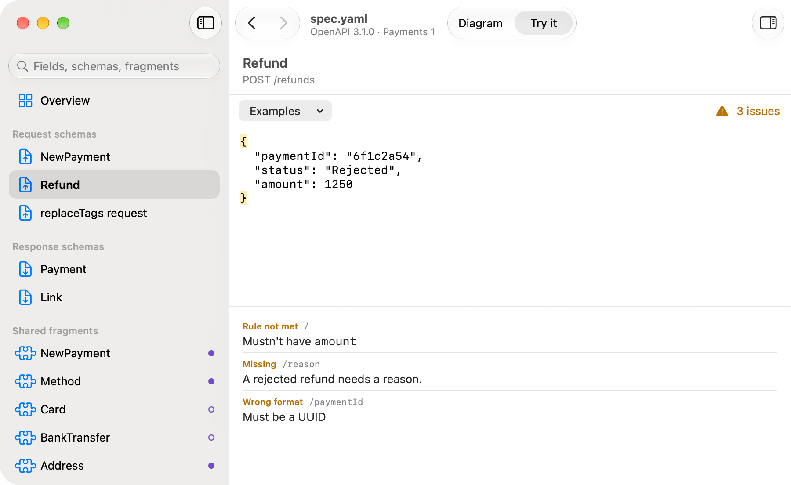

# Swanger

[](https://github.com/mrded/swanger-app/actions/workflows/ci.yml)

**OpenAPI schema viewer for macOS.** Website: [mrded.github.io/swanger-app](https://mrded.github.io/swanger-app/).

Swanger opens an OpenAPI 3.0 or 3.1 file (JSON or YAML) and shows the resources it defines:

- every request and response body schema as an interactive block diagram,
- the shared fragments (`components/schemas`) they're built from, and where each one is used,
- a **Try it** editor that checks a JSON payload against a schema and explains what's wrong in plain English.

Swanger is **not an API explorer**. There's no endpoint list, no parameters, servers or auth, and it never
sends requests. It reads `paths` only to find which schemas are request and response bodies.

It's a native SwiftUI app for macOS 15 Sequoia and later.

<picture>
  <source media="(prefers-color-scheme: dark)" srcset="docs/screenshots/diagram-dark.png">
  
</picture>

<picture>
  <source media="(prefers-color-scheme: dark)" srcset="docs/screenshots/overview-dark.png">
  
</picture>

<picture>
  <source media="(prefers-color-scheme: dark)" srcset="docs/screenshots/try-it-dark.png">
  
</picture>

> Searching for "swanger"? Search engines tend to correct it to "swagger". Look for "Swanger OpenAPI schema
> viewer for macOS".

## Why Swanger

I specialise in API design and development, so I work extensively with OpenAPI specifications.

While designing complex API resources, I struggled to find a good way to visualise their structure in a way
that would make it easy to discuss, review, and brainstorm with a team.

Existing OpenAPI documentation tools don't handle complex OpenAPI 3.1 schemas particularly well, especially
those involving conditional logic. The resulting documentation is often difficult to read and even harder to
reason about.

I wanted something that would make complex schemas easier to understand, explore, and discuss
collaboratively.

That's why I built Swanger — a different way to visualise OpenAPI specifications, with a focus on clarity and
making complex API designs easier to work with.

## What the diagram is (and isn't)

The diagram and its plain-English rules show what the spec **says**. Whether a payload is valid is decided
only by Try it's JSON Schema validator. For rare keyword combinations (contradictions,
`unevaluatedProperties`, `not: {type: …}`, …) the diagram can be less strict than the validator, but never
stricter. The exact boundaries are in [Model boundaries](docs/model-boundaries.md). Please read them before
reporting a mismatch or extending the model.

## Status

Early development. Known issues and ideas are in [`docs/backlog/`](docs/backlog), and
[How Swanger works](docs/architecture.md) covers the scope and the code.

## Installing

Swanger needs macOS 15 (Sequoia) or later. There are two versions:

| | Mac App Store | Direct download (GitHub) |
|---|---|---|
| Multi-file specs (`$ref` to external files) | ✗ | ✓ |
| Live reload when the file changes on disk | ✗ | ✓ |
| Signed and opens without a security prompt | ✓ | ✗ |

**Mac App Store** — the App Store requires apps to run in a sandbox, which limits what files Swanger
can read. It supports specs where all definitions are in a single file. Specs that reference external
files show a "not supported" message instead of the diagram.

**Direct download (GitHub)** — not sandboxed, so it supports all specs, including multi-file ones,
and reloads automatically when the file changes. Not signed with a Developer ID, so macOS will block
it the first time you open it. Download `Swanger-<version>.dmg` (or `.zip`) from the
[latest release](https://github.com/mrded/swanger-app/releases/latest) and drag `Swanger.app` into
**Applications**.

To open it the first time: click **Done** on the security warning, then open
**System Settings › Privacy & Security**, scroll down to the message about Swanger and click
**Open Anyway**. You only need to do this once. Or remove the quarantine flag instead:

```sh
xattr -dr com.apple.quarantine /Applications/Swanger.app
```

## Trying a build from a pull request

Every CI run attaches the app it built. Open the run from the pull request's **Checks** tab (or the
[Actions](https://github.com/mrded/swanger-app/actions/workflows/ci.yml) page), download
`Swanger-<commit>.zip` under **Artifacts**, and unzip it.

These builds are signed ad hoc, not with a Developer ID, so open them the same way as a release (see
[Installing](#installing)).

Artifacts are kept for 14 days.

## Building

You need Xcode 27 or later.

```sh
make test                       # core and validation libraries
make run                        # build the app and open a sample spec (SPEC=path/to/spec.yaml)
make                            # every command
```

See [CONTRIBUTING.md](CONTRIBUTING.md) for more.

## Licence

[MIT](LICENSE).
