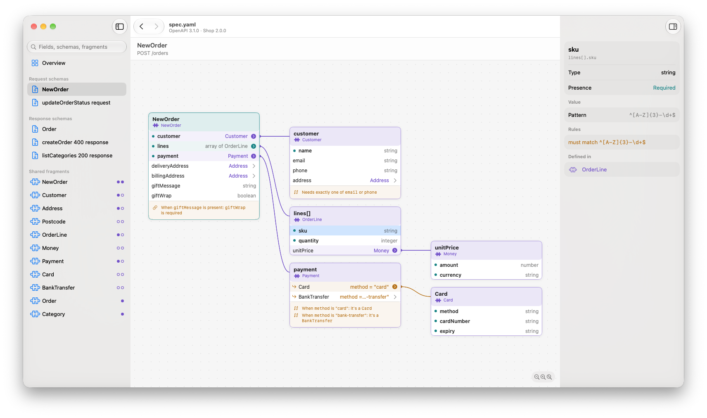
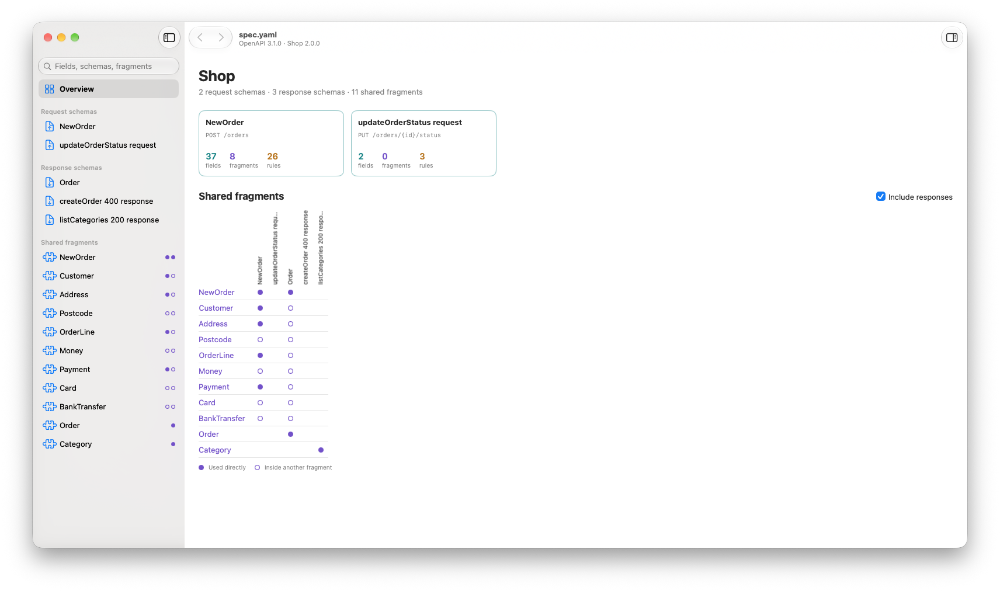

# Swanger

[](https://github.com/mrded/swanger-app/actions/workflows/ci.yml)

**OpenAPI schema viewer for macOS.**

Swanger opens an OpenAPI 3.0 or 3.1 file (JSON or YAML) and shows the resources it defines:

- every request and response body schema as an interactive block diagram,
- the shared fragments (`components/schemas`) they're built from, and where each one is used,
- a **Try it** editor that checks a JSON payload against a schema and explains what's wrong in plain English.

Swanger is **not an API explorer**. There's no endpoint list, no parameters, servers or auth, and it never
sends requests. It reads `paths` only to find which schemas are request and response bodies.

It's a native SwiftUI app for macOS 15 Sequoia and later.

<picture>
  <source media="(prefers-color-scheme: dark)" srcset="docs/screenshots/diagram-dark.png">
  
</picture>

<picture>
  <source media="(prefers-color-scheme: dark)" srcset="docs/screenshots/overview-dark.png">
  
</picture>

> Searching for "swanger"? Search engines tend to correct it to "swagger". Look for "Swanger OpenAPI schema
> viewer for macOS".

## What the diagram is (and isn't)

The diagram and its plain-English rules show what the spec **says**. Whether a payload is valid is decided
only by Try it's JSON Schema validator. For rare keyword combinations (contradictions,
`unevaluatedProperties`, `not: {type: …}`, …) the diagram can be less strict than the validator, but never
stricter. The exact boundaries are in the plan's
[Model boundaries](docs/plans/20261020-swanger-v1.md#model-boundaries). Please read them before reporting a
mismatch or extending the model.

## Status

Early development. See [the v1 plan](docs/plans/20261020-swanger-v1.md) for what's coming.

## Trying a build from a pull request

Every CI run attaches the app it built. Open the run from the pull request's **Checks** tab (or the
[Actions](https://github.com/mrded/swanger-app/actions/workflows/ci.yml) page), download
`Swanger-<commit>.zip` under **Artifacts**, and unzip it.

These builds are signed ad hoc, not with a Developer ID, so macOS will refuse to open them at first. Either
right-click `Swanger.app` and choose **Open**, then **Open** again, or remove the quarantine flag:

```sh
xattr -dr com.apple.quarantine Swanger.app
```

Artifacts are kept for 14 days.

## Building

You need Xcode 27 or later.

```sh
make test                       # core and validation libraries
make run                        # build the app and open a sample spec (SPEC=path/to/spec.yaml)
make                            # every command
```

See [CONTRIBUTING.md](CONTRIBUTING.md) for more.

## Licence

[MIT](LICENSE).
